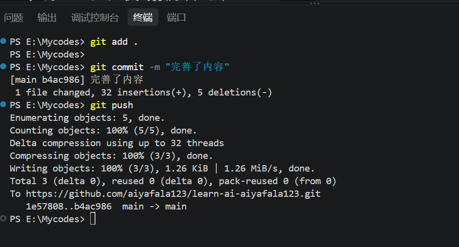

# 学习日记

---

这是我第一篇由 Markdown 写的文章,主要是为了记录我自己的成长。如有不足还请各位大佬提出意见。

---

## 初见 **Markdown**  

### 关于我为什么要学这些？

原因如下：

- ~~可以装逼~~
- ~~想在简历上随便凑几行字，显得自己很厉害~~
- [x] **成为技术大佬!!!**

### 学到的冷知识

有很多冷知识是在我深入学习 Markdown 才知道的,例如:
>
> 1. 多数技术文档初稿都是由 Markdown 撰写的。
> 2. 很多开源项目的 README 都是用它写的
>

### 学习感悟

不得不说，Markdown 真的是一个伟大的发明，用起来是真的方便。

| 状态 | 优点 |
| :-----: | :-------: |
| ✅ | 语法简单、好记 |
| ✅ | 几乎可以用任何文本编辑器打开 |
| ✅ | 0基础就能学，上手简单 |  

我之前写 Word 文档，还要调行间距之类的，经常把时间花到那。用 Markdown 我只要管内容和结构就行，节省了许多时间。

---

## 初见 **Python**

### 第一个程序

我学的教程来自一个大佬的仓库[Python-100-Days](https://github.com/jackfrued/Python-100-Days "很好的教程，使我心潮澎湃"),作为一个 0 基础小白，大佬写的非常简单易懂。在我阅读完后，我写下了我的第一个 Python 程序:

```python
print('Hello, World!')
```

并上传到了我的仓库 [第一个Python程序](https://github.com/aiyafala123/learn-ai-aiyafala123/blob/main/foundation_0_task3.py) 。



### 学习体会

 我学过一点C、C++,随着我更加深入地学习Python，我发现，相比于 C、C++，Python 的语法真的很简洁，方便，例如没有繁琐的分号、花括号、头文件，可读性很强。这确实符合网上对它的评价。接下来，我会继续学习，朝着目标前进。

---

## 结语

大概就是这些了，虽然内容很短，但也花费了我几个小时的时间。写这篇文章的时候我不禁想起了小时候的自己：  

当时什么也不懂，电脑出什么问题，就去贴吧、知乎等各种地方寻找解决办法，这个方法不行换另一个，经常要花费一早上时间才能解决这些问题。

而现在，我写这篇文章也在网上查语法，去找 VS Code 上出现的一些问题的解决办法，找教程配环境。仿佛像是回到了小时候。变的是问题，不变的是“不懂就搜，不行再搜”的决心，虽然很笨，但也培养了我的求知精神。

这或许就是成长的必经之路吧，乔布斯曾说过：

> Stay hungry, stay foolish.[^1]

[^1]: 保持求知若渴、虚心若愚

我相信，即使是个小白，只要一直保持这种探索的好奇心，就一定能走到更远的地方！
